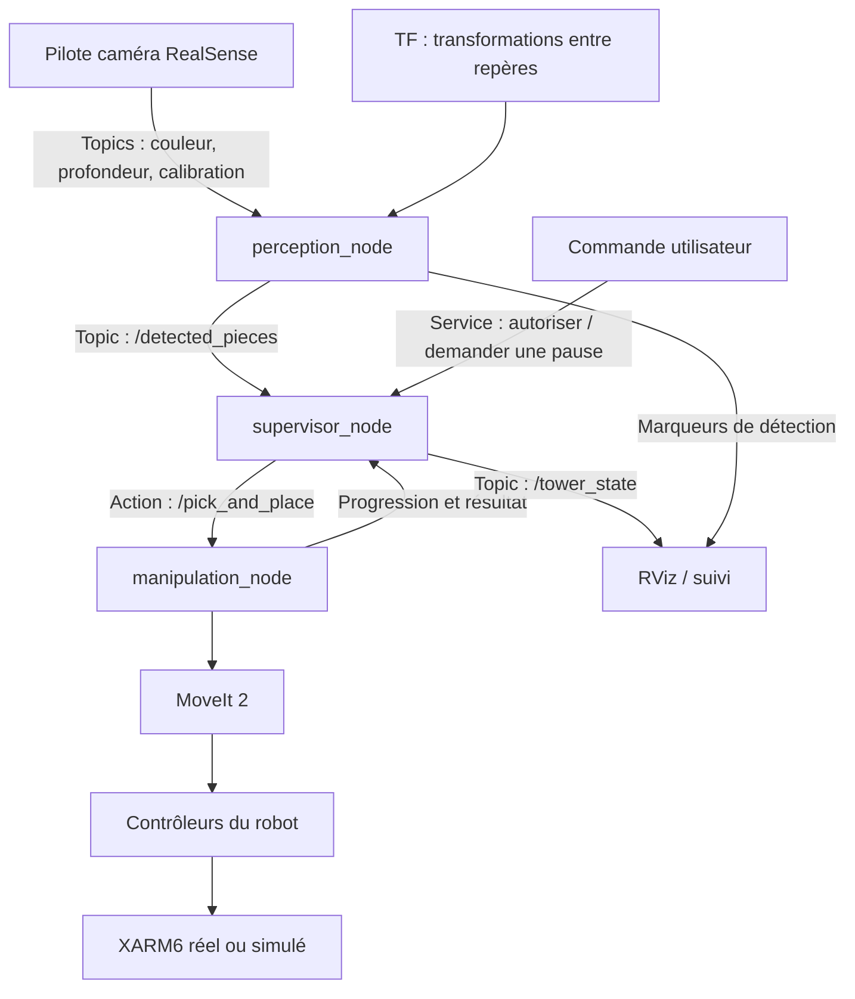

# Introduction au projet : construction d’une tour avec le XARM6

## 1. Objectif du projet

Le projet consiste à programmer un bras robotisé XARM6 pour construire une tour aussi haute et stable que possible à partir de pièces de différentes tailles et couleurs.

Le système doit être capable de :

1. Observer les pièces disponibles avec la caméra.
2. Détecter leur couleur, leurs dimensions et leur position.
3. Choisir la prochaine pièce à empiler et sa position de dépose.
4. Commander le bras pour saisir et déposer cette pièce.
5. Vérifier le résultat avant de recommencer.

L’évaluation porte notamment sur la hauteur de la tour, la stabilité, la précision et la rapidité de construction, ainsi que sur la présentation et l’implication individuelle.

Le temps total annoncé est de **24 heures**, avec un accès limité au robot. La priorité est donc d’obtenir rapidement un empilage fiable de quelques pièces, puis d’améliorer la stratégie.

Le sujet demande de reconnaître les couleurs, mais ne précise pas d’ordre de couleurs à respecter. Une première stratégie pourrait privilégier les grandes surfaces d’appui à la base, puis les plus petites au-dessus. Cette heuristique devra être testée selon la forme et les propriétés des pièces.

> Le sujet mentionne à la fois 1 h 30 d’évaluation dans les contraintes et les deux dernières heures réservées à l’évaluation. Le créneau exact sera à confirmer avec l’encadrant. Le passage annoncé par groupe dure 30 minutes : 15 minutes de présentation, 5 minutes de démonstration et 10 minutes de questions.

## 2. Les concepts ROS 2 à utiliser

### Nœud

Un **nœud** est un programme chargé d’une responsabilité : traiter les images, superviser la construction ou exécuter une manipulation, par exemple.

Un même nœud peut être publisher, subscriber, client et serveur. Ces termes décrivent ses rôles dans les communications.

### Topics, publishers et subscribers

Un **topic** est un canal de diffusion de messages :

- Le **publisher** publie les données.
- Les **subscribers** s’abonnent au topic pour les recevoir.

Ce mécanisme convient aux données produites régulièrement : images, détections, positions articulaires et état de la tour.

Exemple : le pilote de la caméra publie les images et le nœud de perception s’y abonne.

### Services, clients et serveurs

Un **service** permet à un client d’envoyer une requête à un serveur, qui retourne une réponse.

Ce mécanisme convient aux demandes courtes : autoriser la construction, demander une pause ou réinitialiser l’état interne lorsque le système est au repos.

Une réponse à une demande de pause peut confirmer sa prise en compte ; l’état publié par le superviseur doit ensuite indiquer quand la pause est effective.

### Actions

Une **action** permet de demander une tâche longue et d’obtenir :

- Une acceptation ou un refus de l’objectif.
- Des informations de progression.
- Un résultat final.
- La possibilité de demander une annulation.

Une action est adaptée à une opération comme « saisir cette pièce et la déposer sur la tour ». Le serveur doit implémenter la gestion de l’annulation et l’arrêt du mouvement correspondant.

| Mécanisme | Utilisation proposée |
|---|---|
| Topic | Images, pièces détectées, état de la tour |
| Service | Autorisation de construire, demande de pause, réinitialisation |
| Action | Saisie et dépose d’une pièce |

Référence : [fonctionnement des actions ROS 2](https://design.ros2.org/articles/actions.html).

## 3. Ce qui existe déjà dans le dépôt

Le dépôt contient actuellement un exemple dans le package `sorting`.

Dans [sorting.cpp](src/sorting/src/sorting.cpp), le nœud `sorting` :

- S’abonne au topic `/hello`.
- Trie les lettres du texte reçu lorsque le traitement est activé.
- Publie le résultat sur `/sorted`.
- Fournit le service `/toggle_sorting`, qui inverse l’état d’activation du traitement.

Le fichier [ToggleSorting.srv](src/sorting_msgs/srv/ToggleSorting.srv) définit une requête vide et une réponse contenant l’état d’activation et un message.

Cet exemple constitue une base pour comprendre les communications ROS 2. La perception, la supervision et la manipulation du robot restent à développer ou à intégrer.

## 4. Architecture proposée

Pour commencer, trois nœuds applicatifs suffisent :

1. `perception_node` : détecter et localiser les pièces.
2. `supervisor_node` : décider de la prochaine opération et suivre la construction.
3. `manipulation_node` : exécuter les opérations de saisie et de dépose.

Les pilotes de la caméra, MoveIt et les contrôleurs du XARM6 sont fournis par des packages existants.

Les noms de nœuds et d’interfaces ci-dessous sont des propositions pour le projet. Les noms exacts des interfaces des pilotes dépendront de leur configuration.



| Nœud ou composant | Responsabilité | Communications principales |
|---|---|---|
| Pilote RealSense | Fournir les données caméra | Publie les images couleur, la profondeur et les paramètres de calibration |
| `perception_node` | Reconnaître les pièces et estimer leur pose | Reçoit les images et utilise TF ; publie `/detected_pieces` |
| `supervisor_node` | Choisir les pièces et les placements, gérer les erreurs | Reçoit les détections ; client de `/pick_and_place` ; publie `/tower_state` |
| `manipulation_node` | Réaliser une saisie et une dépose | Serveur de `/pick_and_place` ; utilise MoveIt et commande la pince |
| MoveIt et contrôleurs XARM | Planifier et exécuter les trajectoires | Utilisent les interfaces fournies par les packages du robot |

Le dépôt [xarm_ros2](https://github.com/xArm-Developer/xarm_ros2) fournit notamment les modèles du bras, les interfaces de commande et les configurations MoveIt.

## 5. Nœud de perception

Une première implémentation est disponible dans [tower_perception](src/tower_perception/README.md).
Elle mémorise la dernière paire d'images couleur/profondeur alignée et lance
l'analyse à l'appel du service `/perception/analyze_image` ou à la réception
d'un message sur `/perception/analyze`. Le résultat est publié sous forme de
`PieceArray` sur `/detected_pieces` et retourné également par le service.
Un [récepteur minimal côté contrôle](src/tower_control/README.md) conserve ce
vecteur ; les mouvements du bras restent à développer.

### Entrées et traitement

Le nœud reçoit les images couleur, la profondeur et les informations de calibration de la caméra.

Une première approche avec OpenCV pourrait être :

1. Segmenter les images selon la couleur.
2. Extraire les contours des pièces.
3. Estimer leur centre et leur orientation dans l’image.
4. Utiliser la profondeur et la calibration pour estimer leur position et leurs dimensions en 3D.
5. Transformer les résultats dans le repère utilisé pour commander le robot.

`cv_bridge` permet de convertir les images ROS en images manipulables avec OpenCV.

### Données à publier

Le topic `/detected_pieces` pourrait transporter une liste de pièces avec, pour chacune :

```text
identifiant
couleur
position et orientation
dimensions
repère et date de la mesure
```

La pose correspond à la position et à l’orientation d’une pièce. L’identifiant doit rester cohérent entre observations lorsque cela est possible, pour éviter de confondre les pièces.

### Calibration et repères

Une position mesurée dans le repère de la caméra doit être transformée dans le repère du robot grâce à **TF**, le système de transformations entre repères de ROS.

- Si la caméra est fixe par rapport à la table et au robot, la transformation peut être constante après calibration.
- Si la caméra est fixée au bras, la transformation dépend de la position du bras à la date de l’image.

L’alignement entre couleur et profondeur est également nécessaire pour associer la bonne distance à chaque détection.

## 6. Nœud de supervision

Le superviseur coordonne la construction. Il conserve notamment :

- Les pièces disponibles et les pièces déjà utilisées.
- La position de la tour et sa hauteur estimée.
- La prochaine pièce à saisir et sa destination.
- L’état de l’opération en cours et les éventuelles erreurs.

Une machine à états simple permet d’organiser son comportement :

```text
ATTENTE
   ↓
OBSERVATION
   ↓
CHOIX DE LA PIÈCE ET DU PLACEMENT
   ↓
MANIPULATION
   ↓
VÉRIFICATION
   ├── succès : nouvelle observation pour la pièce suivante
   ├── échec récupérable : nouvelle observation et tentative limitée
   └── fin ou échec bloquant : arrêt de la construction
```

Le superviseur ne doit pas considérer une pièce comme empilée sur la seule base de l’envoi d’une commande. Il attend le résultat de la manipulation, puis vérifie le placement avec les observations disponibles.

Pour commencer, la stratégie et la vérification peuvent rester dans ce nœud. Un nœud dédié à la stabilité pourra être ajouté si la complexité le justifie.

## 7. Nœud de manipulation

Le nœud de manipulation fournit l’action `/pick_and_place`.

| Partie de l’action | Contenu proposé |
|---|---|
| Objectif | Identifiant de pièce, pose de saisie, dimensions, pose de dépose |
| Progression | Étape courante : approche, saisie, transport ou dépose |
| Résultat | Succès ou échec, étape concernée et message d’erreur |

La séquence de manipulation serait :

1. Se placer au-dessus de la pièce.
2. Descendre vers la pose de saisie.
3. Fermer la pince et vérifier la saisie selon les retours disponibles.
4. Soulever la pièce.
5. Se déplacer au-dessus de la tour.
6. Descendre vers la pose de dépose.
7. Ouvrir la pince.
8. Retirer le bras pour permettre la vérification visuelle.

La pose de la pièce et la pose de la pince sont différentes : le calcul doit tenir compte du décalage entre l’outil et l’objet.

La table, la tour et la pièce transportée doivent être représentées dans la scène de collision de MoveIt. La pièce saisie doit être associée au robot pendant son transport, puis replacée dans l’environnement après la dépose. Cela permet de planifier en tenant compte du volume transporté et de la tour déjà construite.

Référence : [scène de planification MoveIt](https://moveit.picknik.ai/humble/doc/examples/planning_scene/planning_scene_tutorial.html), pour les concepts ; l’intégration devra utiliser les interfaces de la version installée.

## 8. Organisation proposée des packages

```text
src/
├── sorting/               # Exemple ROS existant
├── sorting_msgs/          # Interface de l’exemple existant
├── tower_interfaces/      # Messages Piece/PieceArray et service AnalyzeImage
├── tower_model/           # Classe Piece et classes Cube, Rectangle, Cylindre
├── tower_perception/      # Traitement caméra et détection
├── tower_control/         # Supervision et manipulation
└── tower_bringup/          # Fichiers launch et paramètres
```

Un package peut contenir plusieurs nœuds. Il n’est pas nécessaire de créer un package pour chaque nœud.

La bibliothèque C++ [tower_model](src/tower_model/README.md) définit une classe mère abstraite `Piece` et trois classes filles : `Cube` rouge, `Rectangle` bleu (pavé rectangulaire en 3D) et `Cylindre` vert. Ces classes partagent un identifiant et des dimensions, puis définissent chacune leur forme, leur couleur et leur volume. Une fonction convertit les objets en messages `tower_interfaces/msg/Piece` en ajoutant la pose mesurée et la confiance de détection.

Une répartition possible des langages serait :

- **Python avec OpenCV** pour la vision, afin de faciliter les essais.
- **C++ avec `rclcpp` et l’interface MoveIt** pour la manipulation, en cohérence avec le code actuel.
- Python ou C++ pour le superviseur, selon les compétences du groupe.

Les seuils de couleur, poses de référence, vitesses et paramètres de stratégie pourront être placés dans des fichiers YAML chargés par les fichiers launch.

## 9. Simulation et environnement

**RViz** permet de visualiser le robot, les repères, les pièces détectées et les trajectoires. Il sert notamment à vérifier la cohérence entre la vision et les coordonnées du robot.

**Gazebo** simule le robot et la physique des objets. Il permet de tester les manipulations et le comportement de la tour avant les essais réels.

L’environnement du terminal consulté indique **ROS 2 Jazzy**. La [branche Jazzy de xarm_ros2](https://github.com/xArm-Developer/xarm_ros2/tree/jazzy) prévoit Gazebo Harmonic et indique que l’ancien plugin RealSense de simulation n’est pas pris en charge. La simulation caméra devra donc être vérifiée tôt dans le projet.

L’objectif est de conserver les mêmes interfaces applicatives en simulation et en réel, en adaptant les pilotes, paramètres et fichiers launch.

## 10. Ordre de développement recommandé

1. **Afficher et déplacer le XARM6 dans RViz.** Vérifier le modèle, la pince et la planification avec les packages fournis.
2. **Saisir et déposer une pièce à des coordonnées connues.** Valider la manipulation avant d’ajouter les incertitudes de la vision.
3. **Détecter une pièce et afficher sa position dans RViz.** Vérifier les dimensions, les repères et la calibration.
4. **Relier la perception à la manipulation.** Réaliser une saisie à partir d’une position détectée.
5. **Empiler deux ou trois pièces.** Valider la hauteur de dépose et le retrait du bras.
6. **Ajouter la stratégie et la gestion des erreurs.** Choisir les pièces, vérifier les placements et limiter les nouvelles tentatives.
7. **Optimiser et préparer la démonstration.** Améliorer les trajectoires, mesurer les résultats et documenter les essais.

## 11. Répartition possible du travail

| Partie | Travail principal |
|---|---|
| Perception | Caméra, couleurs, dimensions, localisation et calibration |
| Manipulation | MoveIt, pince, trajectoires et action de saisie-dépose |
| Supervision et stabilité | Stratégie, machine à états, vérification et reprises sur erreur |
| Intégration et démonstration | Launch, simulation, essais réels et suivi des performances |

Les interfaces doivent être définies ensemble dès le départ : données d’une pièce, repère des poses, contenu de l’action et signification des résultats. Chaque partie pourra ensuite être développée avec des données simulées avant l’intégration complète.

## Références

- [Sujet du projet](projet.md)
- [Packages ROS 2 du XARM](https://github.com/xArm-Developer/xarm_ros2)
- [Branche XARM pour ROS 2 Jazzy](https://github.com/xArm-Developer/xarm_ros2/tree/jazzy)
- [Pilote ROS des caméras RealSense](https://github.com/realsenseai/realsense-ros)
- [Actions ROS 2](https://design.ros2.org/articles/actions.html)
